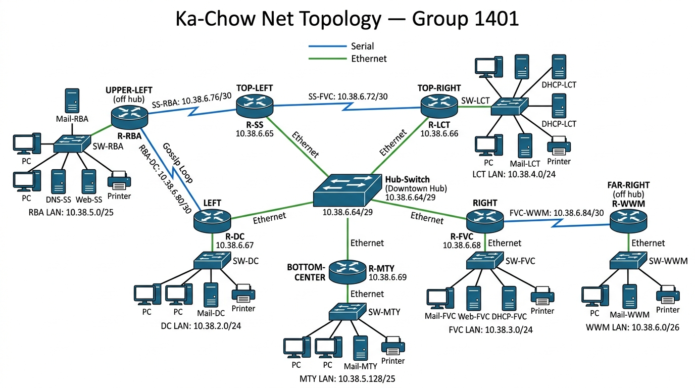

# Ka-Chow Net: The Radiator Springs Network

A computer networking design and configuration project developed for **CSE 421 (Computer Networks)** in **Summer 2026**. This repository contains the complete network topology, router configurations, architectural documentation, and team work distribution for **Ka-Chow Net — The Radiator Springs Network**.



## Table of Contents

* [Project Overview](#project-overview)
* [Repository Structure](#repository-structure)
* [Key Deliverables](#key-deliverables)
* [Getting Started](#getting-started)
  * [Prerequisites](#prerequisites)
  * [Viewing & Testing the Network](#viewing--testing-the-network)
* [Authors & License](#authors--license)

## Project Overview

**Ka-Chow Net** models and implements a multi-segment enterprise/municipal network inspired by *Radiator Springs*. The project covers network topology design, IP addressing and subnetting, routing protocol configuration, and end-to-end connectivity verification.

*(Optional: Add a brief bulleted list here of the specific protocols or technologies used in your configuration, such as VLANs, OSPF/RIP/Static Routing, DHCP, NAT, ACLs, etc.)*

## Repository Structure

```text
CSE-421-Summer-2026-Project/
├── 4. Ka-Chow Net_ The Radiator Springs Network   # Project specification / problem statement
├── KaChowNet_Router_Configs.txt                   # Cisco IOS CLI commands & router configuration scripts
├── KaChowNet_Solution.md                          # Complete network design & solution documentation (Markdown)
├── KaChowNet_Solution.pdf                         # Complete network design & solution documentation (PDF)
├── KaChowNet_Topology.jpg                         # Visual diagram of the Radiator Springs network topology
├── KaChowNet_WorkDistribution.md                  # Team member roles & task breakdown (Markdown)
├── KaChowNet_WorkDistribution.pdf                 # Team member roles & task breakdown (PDF)
├── LICENSE                                        # Repository license
└── README.md                                      # Project overview and guide
```

## Key Deliverables

* **Network Topology (`KaChowNet_Topology.jpg`):** Visual layout illustrating routers, switches, end devices, subnets, and interconnections across the Radiator Springs network.
* **Router Configurations (`KaChowNet_Router_Configs.txt`):** Full CLI configuration snippets ready to be applied to network devices for interface addressing, routing, and network services.
* **Solution Documentation (`KaChowNet_Solution.md` / `.pdf`):** Detailed write-up covering IP addressing tables, subnetting calculations, routing logic, and verification steps.
* **Work Distribution (`KaChowNet_WorkDistribution.md` / `.pdf`):** Breakdown of individual contributions and responsibilities across the project team.

## Getting Started

### Prerequisites

* **Cisco Packet Tracer** (or **GNS3** / **EVE-NG**) to simulate and test the network topology.
* A Markdown viewer or PDF reader to inspect the documentation files.

### Viewing & Testing the Network

1. **Clone the repository:**
   ```bash
   git clone https://github.com/lubanlatif/CSE-421-Summer-2026-Project.git
   cd CSE-421-Summer-2026-Project
   ```

2. **Review the Architecture:**
   * Open `KaChowNet_Topology.jpg` to inspect the physical and logical layout.
   * Read `KaChowNet_Solution.pdf` (or `KaChowNet_Solution.md`) for the IP allocation scheme and design rationale.

3. **Apply Configurations:**
   * Replicate the topology in Cisco Packet Tracer (or open your `.pkt` simulation file if stored locally).
   * Copy the corresponding device configurations from `KaChowNet_Router_Configs.txt` into each router's CLI in privileged/global configuration mode.
   * Verify connectivity across subnets using `ping`, `traceroute`, and `show ip route`.

## Authors & License

* **Maintainer:** Luban Latif (`@lubanlatif`) & Team *(see `KaChowNet_WorkDistribution.md` for full contributor details)*
* **Course:** CSE 421 — Summer 2026
* **License:** Distributed under the terms specified in the [`LICENSE`](./LICENSE) file.